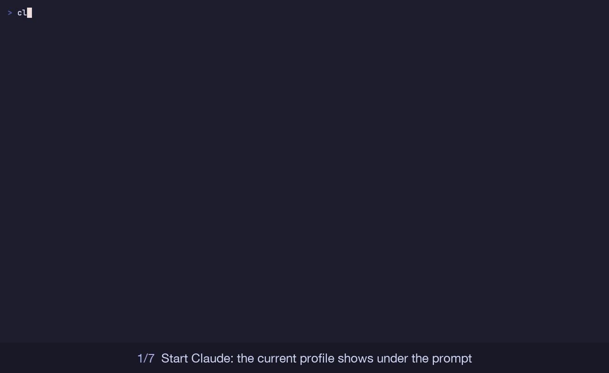

# claude-config

My Claude Code setup, so a new machine is one command away.

## What's inside

| Path | What it is |
| --- | --- |
| `mods/agent-monitor` | **Agent monitor**, a sidebar pane for subagents and workflow agents (details below) |
| `mods/profiles` | **Profiles**, several Claude Code logins over one shared setup (details below) |
| `plugins/core` | **gvart-skills**: my skills `design-ship`, `orchestrate` and `smart-build`, and the agents `ui-ux-designer` and `frontend-component-builder` |
| `claude/CLAUDE.md` | My global instructions: semantic commits, no AI co-author, think before coding, keep changes small |
| `install.sh` | Installs all of the above, plus [Matt Pocock's skills](https://github.com/mattpocock/skills) from upstream |

### Agent monitor

A side pane showing every subagent and workflow agent as it works (progress, current step, tokens), with Pause, Stop and Message on each card, plus session spend and plan limits.


Details: [mods/agent-monitor/README.md](mods/agent-monitor/README.md).

### Profiles

Several Claude accounts (personal, work, another subscription) sharing one setup, each with its own login and history. `/profile` switches between them, and the current one shows under the prompt.



Commands and details: [mods/profiles/README.md](mods/profiles/README.md).

## Install

```bash
git clone https://github.com/gvart/claude-config.git ~/claude-config
~/claude-config/install.sh
```

The script adds this repo as a plugin marketplace and installs `agent-monitor`, `profiles`, `gvart-skills` and `mattpocock-skills`. It then links `~/.claude/CLAUDE.md` to the copy in the repo, first backing up any existing file.

To install only one of the mods, run this in a Claude Code terminal session:

```
/plugin install agent-monitor --marketplace gvart/claude-config
/plugin install profiles --marketplace gvart/claude-config
```

## Developing the mods

```bash
claude plugin validate mods/agent-monitor
claude plugin test mods/agent-monitor
claude --plugin-dir mods/agent-monitor   # run it from this folder
# the same for mods/profiles
```

## License

MIT. Matt Pocock's skills aren't included in this repo; the install script fetches them from his repository, which has its own MIT license.
