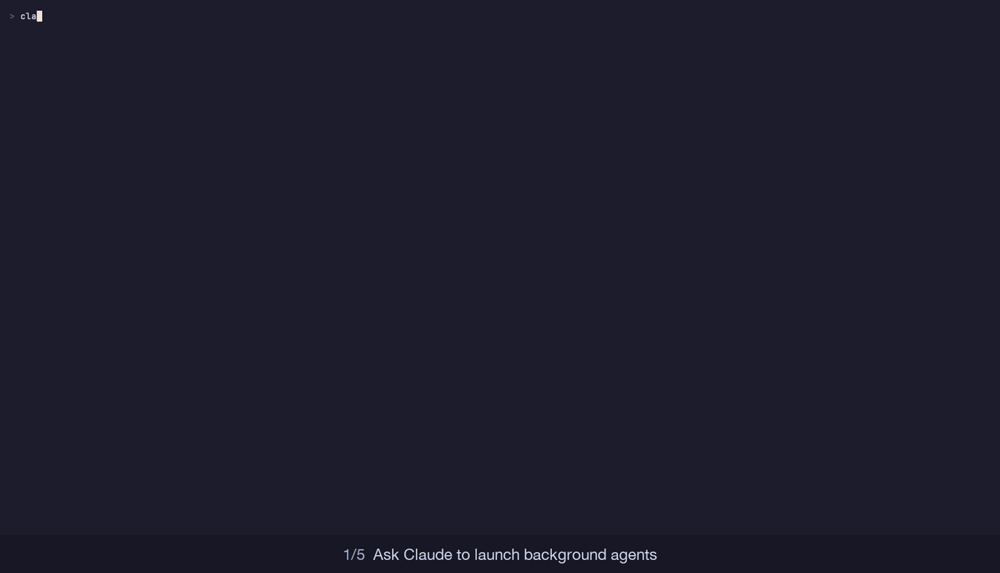

# Agent monitor

A side pane that shows every subagent and workflow agent as it works, with controls to pause, stop or message each one. Works in the terminal and in the Code tab of the Claude desktop app.



## Install

```
/plugin install agent-monitor --marketplace gvart/claude-config
```

The pane opens by itself when an agent starts; `/agent-monitor` opens it any time.

## What it shows

- **A card per agent:** a pixel avatar for its role, status, progress bar, current step, elapsed time, tokens and tool calls
- **Card controls:** Pause/Resume, Stop, Message (your next prompt goes to that agent) and Info
- **Top bar:** Pause all, Stop all, overall progress, session spend, and how much of your plan's 5-hour and weekly limits is left
- **Stuck detection:** a card's border flashes after 2 minutes without activity
- **Cleanup:** Dismiss a card, Clear ended, or Auto-clear finished agents after a minute

## How it works

Agents report their own progress through a `report_progress` tool the mod adds. Pause takes effect at the agent's next tool call; Stop refuses further tool calls and asks the agent to hand back its report.
